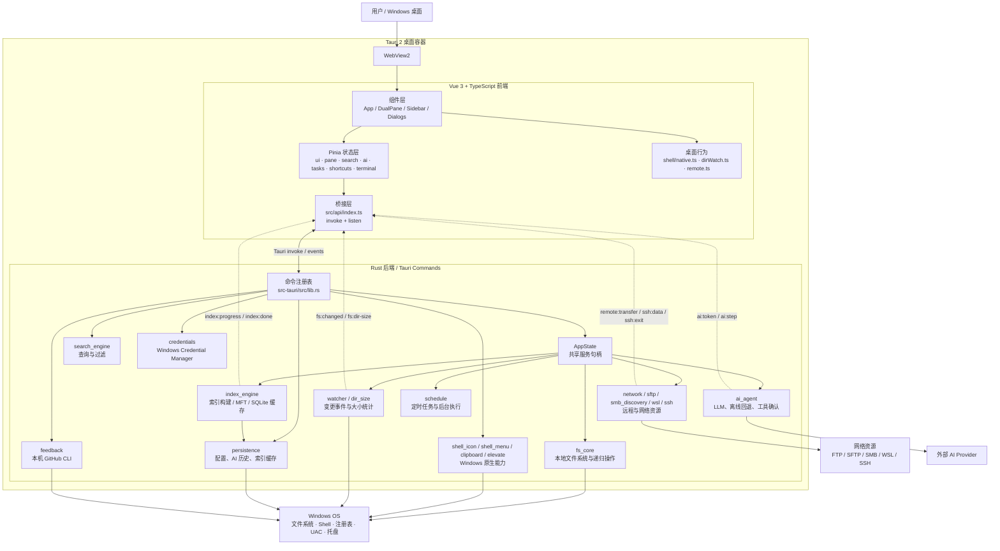

# Stelix（星索）架构图

> 本图按当前代码实现整理，入口主要对应 `src/App.vue`、`src/api/index.ts` 与 `src-tauri/src/lib.rs`。

## 一、功能架构图

```mermaid
flowchart TB
    APP[Stelix 文件管理器]

    APP --> SHELL[桌面交互壳]
    APP --> FILES[文件管理]
    APP --> SEARCH[索引与搜索]
    APP --> AI[AI 助手]
    APP --> TASKS[自动化任务]
    APP --> SETTINGS[设置与反馈]

    SHELL --> TITLE[标题栏\n拖动 / 最大化 / 系统菜单]
    SHELL --> ACTIVITY[活动栏与侧边栏]
    SHELL --> COMMAND[命令面板与快捷键]
    SHELL --> STATUS[状态栏 / 进度提示]

    FILES --> NAV[双窗格导航]
    FILES --> LOCAL[本地磁盘 / 驱动器]
    FILES --> REMOTE[远程资源\nFTP / SFTP / SMB / WSL / SSH 终端]
    FILES --> OPS[文件操作\n复制 / 移动 / 删除 / 重命名 / 新建]
    FILES --> SYSTEM[Windows 系统集成\n图标 / 右键菜单 / 属性 / 终端 / 打开方式]
    FILES --> CLIP[剪贴板与提权操作]

    SEARCH --> BUILD[全盘索引\n增量更新 / MFT 预留]
    SEARCH --> QUERY[文件名与属性检索\n过滤 / 排序 / 结果跳转]
    SEARCH --> WATCH[目录监听与变更刷新]
    SEARCH --> SIZE[目录大小统计]

    AI --> CHAT[对话与流式回复]
    AI --> CONTEXT[当前路径 / 选中文件上下文]
    AI --> TOOLS[工具调用\n读操作直接执行 / 写操作批量审批]
    AI --> PLAN[自然语言生成任务草稿]

    TASKS --> CRUD[任务增删改 / 启停]
    TASKS --> PREVIEW[Dry-run 预演]
    TASKS --> SCHEDULE[后台调度与立即执行]

    SETTINGS --> PREF[外观 / 快捷键 / 启动设置]
    SETTINGS --> AICONFIG[AI Provider 与模型配置]
    SETTINGS --> HISTORY[AI 对话历史]
    SETTINGS --> FEEDBACK[GitHub Issue 反馈]
```

## 二、技术架构图

## 关键边界

- 前端只通过 `src/api/index.ts` 调用后端，不直接执行文件系统操作。
- Rust 通过 `AppState` 持有索引、AI、任务、监听和目录大小等长生命周期服务。
- 文件系统变更、索引进度、AI 流式输出和远程传输进度采用 Tauri 事件回传前端。
- AI 写操作会先经过只读预检，再由前端逐项确认后才进入 `fs_core`；待审批的 Agent run 保存在后端内存中，执行结果继续回灌模型。配置、历史和索引缓存由 `persistence` 负责落盘，AI 写操作审计追加到 `ai-audit.jsonl`。
- Windows 原生右键菜单按**整份选中集**创建（`shell_menu` 多选走 `IShellItemArray`，单选走父 `IShellFolder` + 子 PIDL）：7-Zip「添加到压缩包」、系统压缩、复制 / 剪切 / 删除 / 属性等系统项都作用于全部选中项，多选不得退化成「只处理被右键的那一项」。菜单末尾的应用自定义项仍由前端按 `tab.selected` 分发。
